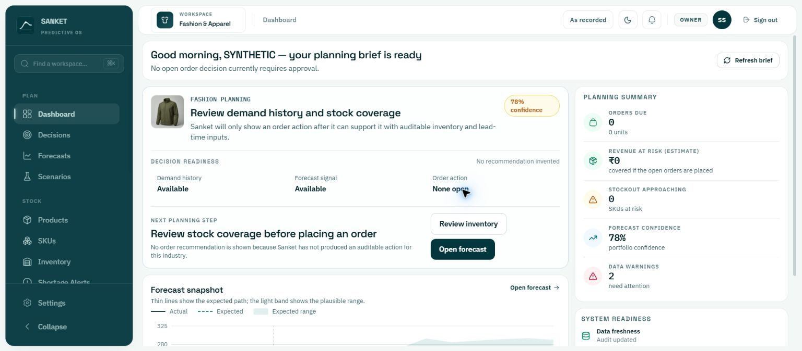
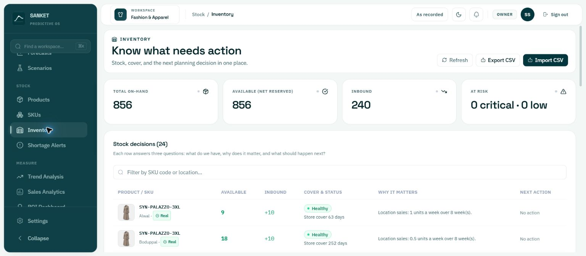
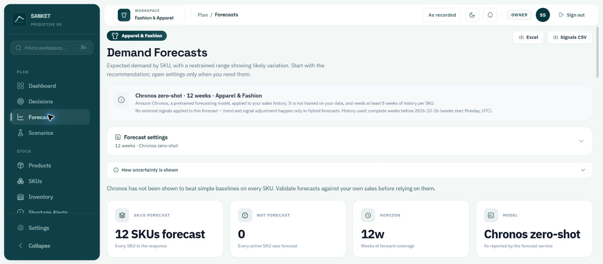
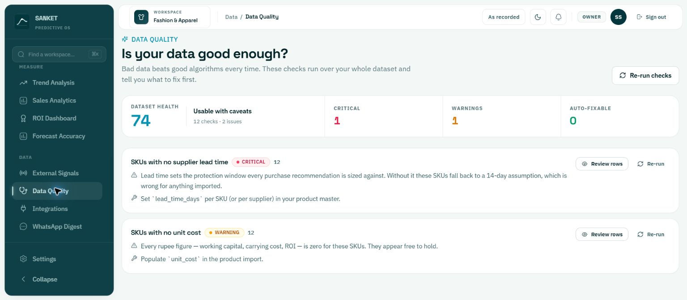
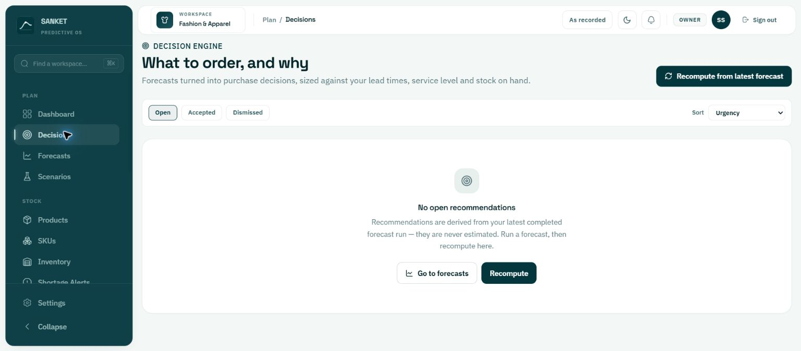

# SANKET workspace review — 2026-10-26

Read-only review of the current signed-in Fashion & Apparel workspace in Chrome. No production source was changed.

## Overall
The teal design system, navigation grouping, explanatory inventory rows and explicit forecast model disclosure are strong. Prioritize trustworthy states and a connected planning workflow before adding more screens.

## Reviewed steps
1. Dashboard — usable, but readiness and risk context are incomplete.

2. Inventory — loaded 24 rows; shortage-oriented statuses miss excess-stock opportunities.

3. Forecasts — loaded 12 SKU forecasts with model disclosure; confidence detail is far below the primary view.

4. Data Quality — clear findings: 12 SKUs lack lead time; 12 lack unit cost. Health 74, one critical issue and one warning.

5. Decisions — empty state loads, but generic advice does not explain why recommendations are absent.

## Prioritized improvements

### P1: Make unknowns and assumptions visible at the decision point
Dashboard shows zero stockout risk and ₹0 estimated risk while Data Quality reports missing lead times and unit costs for every SKU. These are observed values, not proof that the calculations are incorrect; the missing-input context is the problem. Show a prominent readiness blocker with affected SKU count, link to repairs, and use Unavailable rather than a monetary zero when valuation cannot be supported. Disclose assumed lead times beside coverage.

Source review: PlanningBriefDashboard.tsx lines 131–132 and 289–304 default missing confidence, warnings and integration counts to zero. Decisions loading/error also falls through to the no-open-decisions state. Distinguish loading, unavailable, stale, empty and confirmed zero states.

### P1: Unify freshness and forecast state
Refresh brief only refetches decisions and forecast (lines 181–182), leaving history, confidence, data quality and integrations unchanged. Refresh relevant dependencies together and show last successful update, source and forecast run ID. Dashboard invokes forecast generation with force_zero_shot true (line 93); prefer displaying the latest selected completed run and make generation explicit. Source evidence, not a measured performance regression.

### P1: Explain the decision empty state
Forecast results exist, but Decisions says to run a forecast and recompute. Distinguish never computed, stale relative to forecast, missing inputs, and successfully computed with no required action. Offer the relevant next action for each state.

### P2: Add excess-stock intelligence
Inventory marks 252 and 466.7 days of cover Healthy and No action. Add configurable excess/slow-moving states, inbound review, transfer and markdown candidates, with seasonality and minimum-stock constraints. These are product opportunities; the current shortage status may be functioning as designed.

### P2: Explain confidence before action
Dashboard shows 78% portfolio confidence; Forecasts reports 8 high and 4 low-confidence SKUs, including 50% scores. Put the low-confidence count beside the summary, link to reasons, explain that a confidence score is not necessarily measured accuracy, and surface held-out accuracy separately.

### P2: Improve provenance
Inventory badges say Real beside SYN-prefixed SKUs in a workspace whose greeting uses SYNTHETIC. This does not prove the stored provenance is wrong. Make the meaning explicit: imported source, synthetic fixture, synchronized record, and observed timestamp; avoid an ambiguous Real badge.

### P3: Improve navigation and density
Search says Find a workspace but filters navigation labels. Rename to Find a page, use a platform-appropriate Ctrl+K hint on Windows, and add keyboard-operable results. Reduce repeated instruction copy and elevate the dashboard chart and warning details. Put summary links directly on actionable counts.

## Statistical review needed
Dashboard aggregateForecast sums per-SKU p10/p90 endpoints (lines 39–41). Marginal quantiles generally do not yield calibrated portfolio quantiles when summed. Validate the dependence assumptions; aggregate joint samples or describe the interval accurately. No calibration experiment was run.

## Accessibility
Strengths: skip link, named navigation, semantic tables, named icon buttons and chart text summaries were visible in the accessibility snapshots. Risks: small muted labels and compact targets need measured contrast/size checks; chart hover information needs keyboard-equivalent access. Keyboard flows, screen-reader announcements, mobile reflow and dark mode were not tested, so this is not a compliance verdict.

## Verification limits
Captured and inspected all five saved screenshots. Reviewed current dashboard, inventory, forecast API and sidebar source. Did not import data, accept recommendations, recompute decisions, change settings or run exports. Frontend typecheck/lint/tests and backend pytest were not run for this read-only review. Existing uncommitted work was preserved. The initial in-app sign-in screenshot is retained as access evidence, not used to judge the workspace.
