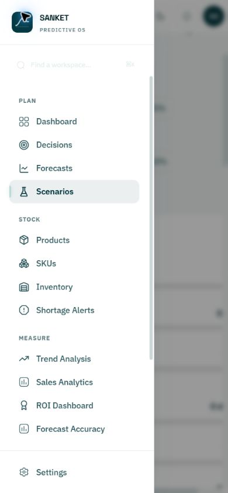
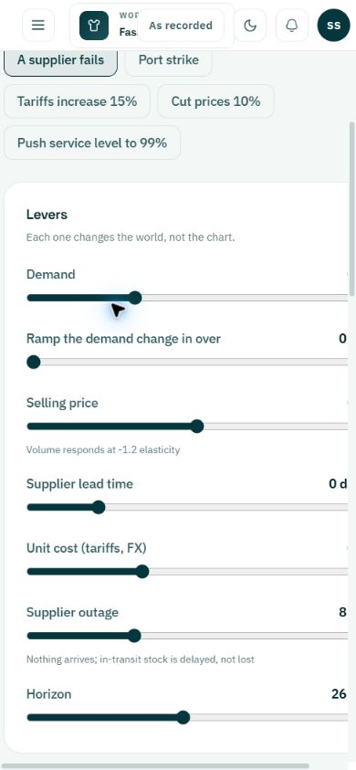

# SANKET deeper audit — 26 October 2026

## Verdict

The highest-priority work is correctness and isolation, followed by planning-state clarity and mobile accessibility. Existing checks pass, but isolated probes expose important behavior outside their current coverage. This review changed no production source and performed no live approvals, imports, connector changes or account switches.

## Verification

| Check | Actual result |
|---|---|
| Frontend `npm run typecheck` | Passed; no TypeScript errors |
| Frontend `npm run lint` | 0 errors, 28 warnings |
| Frontend `npm test` | 36 files, 151 tests passed; 88.46s |
| Backend `uv run pytest` | 528 passed, 108 warnings; 232.88s |
| Cache probe | Account A result returned for reused key; B fetch function called 0 times |
| Expiry handler probe | Recommendation expired 30 days earlier was accepted |
| Simulator probe | 12 input weeks extended to 26; weeks 13–26 repeat the final P50 |
| Mobile | 390×844; navigation focus, contrast and scenario overflow problems reproduced |

The cache probe uses the installed QueryClient library with the application's key and stale-time pattern. The expiry probe calls the actual handler with a fake database boundary. These demonstrate mechanisms; neither is an end-to-end cross-account or database test.

## Findings, in recommended repair order

### 1. P1 — Account changes do not isolate the frontend cache

**Evidence:** `frontend/src/App.tsx:116` creates a module-level QueryClient. `frontend/src/stores/auth.ts:349–372` clears session state but does not cancel or clear queries. A full source search found no query-cache clearing on identity changes. Dashboard keys such as `['decisions', industry, 'open']` omit tenant and user; integration keys omit even industry.

**Reproduction:** `cache-probe.mjs` stores a synthetic A result, then fetches with a B function and the same key. It returns A and makes zero B network calls while fresh.

**Impact:** A second account in the same SPA can see cached information from the previous account. Stale queries can also show old data during refetch. PostgreSQL RLS cannot protect data already held in the browser.

**Fix:** Scope all tenant-owned keys by verified tenant ID (and user/role where appropriate), cancel in-flight work and remove prior identity caches on sign-out and identity transitions. Add a two-account same-industry regression test. No claim of server-side RLS bypass is made.

### 2. P1 — Recommendation expiry is recorded but not enforced at acceptance

**Evidence:** `backend/app/services/decision_builder.py:413` writes `expires_at`; `backend/app/routers/decisions.py:180–182` checks only `status == open` before accepting. The list endpoint also does not filter by expiry. No recommendation-expiry enforcement was found elsewhere in app source.

**Reproduction:** `diagnostics.py` supplies the real handler an open recommendation whose expiry is 30 days in the past; it becomes accepted.

**Fix:** Reject time-expired recommendations server-side, expire or exclude them from open queues, and explain that fresh computation is needed. Add a real database regression, including acceptance at the boundary. This probe did not modify live recommendations.

### 3. P1 — Simulator money treats missing costs as free stock

**Evidence:** The Data Quality page reports all 12 SKUs missing unit cost. The simulator displays baseline gross margin ₹56.5L, scenario ₹45.4L, and extra purchase spend ₹0. `backend/app/routers/scenarios.py:166` turns null cost into zero; `scenario.py:244` computes shipped units × (price − cost).

**Reproduction:** The pure probe shows an item with price 100 and absent-as-zero cost produces margin 100 per shipped unit. It demonstrates the mechanism, not a reconciliation of every displayed rupee.

**Fix:** Keep physical quantity simulation available, but withhold unsupported margin/capital metrics and show affected SKU coverage. Distinguish actual zero cost from unknown cost. Surface lead-time assumptions at the same point.

### 4. P1 — Dashboard compares daily actuals with weekly forecasts

**Evidence:** `PlanningBriefDashboard.tsx:98` requests `timeseries('day', 30)`; the forecast is in weekly buckets. Both are supplied to one `ForecastChart` as unconverted units. The forecast page explicitly describes a 12-week horizon.

**Impact:** Apparent demand changes can be caused by different bucket durations rather than actual growth.

**Fix:** Aggregate actuals using the same complete Monday/UTC weeks as the model; label the y-axis units per week. Verify gaps and partial weeks explicitly.

### 5. P1 — Zero-sales history is removed from the chart

**Evidence:** `frontend/src/components/charts/ForecastChart.tsx:66` retains only finite actuals greater than zero. A real zero-sales bucket disappears rather than showing zero; negative values are also excluded without explaining returns handling.

**Fix:** Preserve finite zero values, distinguish missing records from observed zeros, and define the treatment of returns. Add an intermittent-demand chart regression.

### 6. P1 — Forecast and stock freshness gates differ across planning services

**Evidence:** Inventory coverage rejects forecasts older than 14 days and stock older than 30 days. `decision_builder.latest_completed_run` selects the latest completed non-backtest with no age gate; `forecast_bands` reads all dates in that run without restricting to current/future weeks. `inventory.current_levels` aggregates stock without inspecting `as_of`. Decisions and simulator use those functions.

**Impact:** Coverage can say Unknown while another service builds an action from the same outdated inputs. A run from a prior window can be treated as demand from the current week.

**Fix:** Share a dated input-readiness contract across coverage, decisions and simulations. Require future demand coverage and current stock, or explicitly enter an advisory scenario mode. Source-confirmed; stale live data was not injected.

### 7. P2 — The 26-week simulator silently extrapolates a shorter forecast

**Evidence:** `scenario.py:151–154` repeats final P10/P50/P90 values after the available horizon. The actual workspace has 12-week forecasts and a default 26-week simulation.

**Reproduction:** A 12-week probe produces fourteen further weeks all equal to the final value.

**Fix:** Mark forecast-supported and extrapolated periods on the chart and expose the extension assumption; alternatively cap the horizon or generate a sufficiently long run. Do not present all 26 weeks as model output.

### 8. P2 — Errors collapse into empty or safe-looking states

**Evidence:** Inventory destructures loading and data but not query errors, then defaults levels to `[]`. Decisions similarly defaults failed list data to `[]`. Dashboard defaults missing warning/confidence/integration data to zero, and failed decisions can read as no action needed. An error toast cannot make a persistent empty-state claim correct.

**Fix:** Use explicit loading, error, stale, empty and verified-zero states per panel. Preserve last successful values only with their timestamp and error status. The live backend was not deliberately taken offline; this is source evidence.

### 9. P2 — Refresh and import leave dependent coverage stale

**Evidence:** Dashboard Refresh refetches only decisions and forecast. Inventory Refresh refetches only levels; import invalidates `inventory-levels` and `cost-analysis`, but not `inventory-coverage` or decision context (`Inventory.tsx:223–245`). Coverage can therefore lag changed quantities.

**Fix:** Invalidate/refetch the dependent graph together, then display one coherent snapshot/run identity. Add a regression in which changed stock changes cover immediately after import.

### 10. P2 — Mobile navigation search has unsuitable colors

**Observed:** At 390×844, the drawer is white while the search placeholder, shortcut and entered-text styling use near-white/white colors. The search field is very difficult to discover.

**Root:** `Sidebar.tsx:291` applies white text and pale placeholder styling unconditionally, although the dark sidebar surface applies at desktop sizes.

**Fix:** Use semantic colors for the light mobile drawer and desktop-specific overrides. Measure contrast for both themes. No formal WCAG contrast ratio is claimed here.

### 11. P2 — Mobile drawer allows keyboard focus into obscured content

**Reproduction:** Open navigation, press Tab from the Open/Close navigation trigger; focus moves to the currency control behind the backdrop. Opening also leaves focus on the trigger rather than moving into navigation. Sidebar remains in the accessibility snapshot while translated offscreen.

**Root:** No focus containment, background inertness or closed-drawer focus exclusion in the sidebar implementation.

**Fix:** Use an accessible drawer pattern: focus entry, containment, background inertness, Escape dismissal and restoration to the opener. Verify closed navigation cannot receive focus on mobile.

### 12. P2 — Scenario controls overflow the phone viewport

**Measured:** Viewport 390px; main client width 382px and scroll width 428px. Slider right edges reach 403px. The stable screenshot shows controls and values extending beyond the available view.

**Fix:** Allow the grid children to shrink (`min-width: 0` where appropriate), constrain controls to available width, wrap labels and keep only data tables horizontally scrollable. Retest at 320, 390 and 768px.

### 13. P2 — Portfolio uncertainty has an unverified aggregation assumption

**Evidence:** Dashboard sums marginal SKU P10 and P90 values (`PlanningBriefDashboard.tsx:39–41`) and labels the band a plausible range. Those sums are not generally calibrated portfolio P10/P90 endpoints.

**Fix:** Aggregate joint forecast samples with justified dependence assumptions, or clearly name the result as a sum of per-SKU bounds. Validate empirical coverage. No statistical calibration experiment was run.

### 14. P2 — Confidence and risk summaries conceal important composition

**Observed:** Dashboard shows 78% confidence and two warnings. Forecasts identifies four low-confidence SKUs; Data Quality identifies missing supplier lead times for all 12 SKUs. Coverage responses already include `lead_time_assumed`, but Inventory does not display it.

**Fix:** Show low-confidence SKU count, critical blocker count and assumed lead-time badges beside action controls. Link each count to the affected rows. A confidence heuristic must remain distinct from measured production accuracy.

### 15. P3 — Page changes preserve an unrelated scroll position

**Observed:** Moving between screens sometimes opens the new page below its heading, leaving only lower controls or content visible. Main content is a persistent scrolling container (`AppShell.tsx`) with no route-change scroll handling found.

**Fix:** Reset scroll on deliberate navigation to a different page; preserve it for Back/Forward and explicit return-to-row workflows.

### 16. P3 — Additional clarity and operational polish

- Change navigation search placeholder from “Find a workspace” to “Find a page”; show Ctrl+K on Windows.
- “Connections needing your attention” currently includes the healthy CSV Upload connection, duplicating it in the catalogue. Separate problems from ordinary connected sources.
- “Real” inventory badges mean anything except seed/fallback, which does not establish source authenticity. Use explicit provenance.
- Forecast chart accessibility summary describes the first and last P50 as a range; this can omit intermediate extremes. Report endpoints as endpoints, or compute actual min/max.
- Fix the 28 lint warnings in priority order: hook dependencies first, then type gaps. Backend warnings include four unawaited AsyncMock calls in billing tests; correct the fixture contract so warnings do not hide future problems.

## Evidence walkthrough

1. **Dashboard — needs stronger readiness context.** Existing screenshot: [dashboard](../02-dashboard.png). Current source traced for query keys, time buckets, defaults and refresh.
2. **Inventory — filter works, freshness/assumptions need work.** Boduppal filter returned 12 rows, cleared back to 24. Mobile table has its own horizontal overflow; this is preferable to overflowing the whole page. [Mobile inventory](06-mobile-inventory.png).
3. **Forecasts — model disclosure is good.** Loaded 12 SKU forecasts, eight high and four low confidence in the preceding capture. [Forecasts](../04-forecasts.png).
4. **Data Quality — critical findings clearly stated.** Twelve missing lead times and twelve missing costs. [Data Quality](../05-data-quality.png).
5. **Decisions — empty state is generic; expiry and freshness need hardening.** [Decisions](../06-decisions.png). Expiry reproduced only at the isolated handler boundary.
6. **Forecast Accuracy — appropriately distinguishes production and backtests.** No fabricated production accuracy. Backtest summary: 96 points, 12 SKUs, WAPE 18.0%, bias −0.6%, interval coverage 87.5%. These displayed historical results were not independently reconciled. [Accuracy](01-accuracy.png).
7. **ROI — honest empty state.** Clearly calls approvals estimates rather than realized savings. [ROI](02-roi.png).
8. **Integrations — filtering works; attention grouping is noisy.** Available filter excludes coming-soon entries; 42 sources, six live, one connected. No connections changed. [Integrations](03-integrations.png).
9. **Scenarios — meaningful output with undisclosed input assumptions.** Page automatically starts its recommended run on entry. It displayed an Updating badge across captures; timing/root cause was not established, so no permanent-stuck defect is claimed. [Scenario result](07-scenario-current.png).
10. **Mobile navigation — contrast and focus failures.** Open/close navigation and route selection work; search contrast and focus containment do not. [Drawer](05-mobile-navigation.png).
11. **Mobile scenarios — measured horizontal overflow.** [Scenario phone view](08-mobile-scenario.png).

## What was not established

This is not a complete security audit or accessibility certification. No live two-tenant account-switch test, payment transaction, supplier order, acceptance, destructive import, production outage, screen-reader session or full E2E suite was performed. The app automatically issues forecast/simulation requests on page entry; those ordinary route side effects occurred. Existing uncommitted work was preserved. Temporary viewport overrides and search filters were restored.

## Suggested upgrade sequence

1. Tenant-scoped caches and expiry enforcement, each with regressions.
2. Shared readiness/freshness gates and honest unknown monetary states.
3. Weekly-aligned charts, observed zeros and explicit simulation extrapolation.
4. Coherent refresh/import invalidation.
5. Mobile drawer accessibility and scenario reflow.
6. Excess-stock workflows, confidence drill-downs and clearer navigation copy.

Each substantive implementation should follow the repository's approved-design, plan, RED/GREEN and review requirements. This document is an audit, not approval to bypass those stages.
