# Fashion retail V2 architecture proposal

28 October 2026. Review design before implementation. The goal is a dependable mid-sized retail platform with a small canonical model and configurable source adapters. An ERP-sized collection of editable spreadsheets is not the goal.

## 1. Decisions, alternatives and assumptions

| Decision | Alternatives and trade-off | Recommended default |
|---|---|---|
| Internal structure | One wide import table is easy initially but mixes stock, orders and prices. A normalized core requires more adapter logic but preserves business meaning. | Normalize internal entities; flatten only the import interface. |
| Stock authority | External POS/WMS snapshots suit an analytics platform. Internal ledger authority suits an operational ERP. Concurrent authority causes duplicate decrements. | Explicit per tenant/location/SKU-domain authority: external_snapshot or internal_ledger, with effective start time. Begin with external authority for existing customers. Cut over deliberately after a reconciled count. |
| Cost method | FIFO supports lot-cost matching but requires layers. Moving weighted average is simpler for interchangeable fashion pieces. Neither can be reconstructed from a single closing snapshot. | Finance-approved moving weighted average initially, FIFO later if required. No switching methods silently. |
| Fashion attributes | Permanent columns for every garment produce hundreds of mostly empty fields. Unconstrained JSON prevents validation. | Core searchable dimensions plus category-governed typed attributes. |
| Procurement entry | One simple quantity field cannot simultaneously mean ordered and received. Eight separate lifecycle files burden small retailers. | One document-type-aware purchase CSV adapter; separate internal document entities. Add dedicated advanced receipt/invoice/allocation imports when needed. |
| Reports without transactions | Rejecting all aggregates loses useful evidence. Synthesizing line history corrupts analytics. | Separate typed reported aggregate facts with declared grain and period. |

Assumptions: piece-based garments, INR-first with explicit currencies, one tenant may have multiple locations, simple sales CSV records completed recognized/fulfilled sales and cancellations. Reservations, shipments, draft orders, asynchronous receipts and financial adjustments use separate internal services or advanced adapters. No claim that all Indian retailers use one size scheme, tax rate or CSV format.

## 2. Data ownership and fashion modeling

| Information | Owner | Import treatment |
|---|---|---|
| Name, brand, category hierarchy, style, description, collection, season, default tax class, manufacturer | Product master | products.csv; product is a style/group, not stock |
| SKU code, sellable option combination, actual size/color, barcode, GTIN, variant status | SKU master | skus.csv; unique normalized option signature under product |
| Fabric, composition, print, silhouette, sleeve, neckline, length, occasion, care, embellishment | Category attribute definitions plus product values | Validated attributes_json; requiredness depends on category |
| Color-specific image, fabric change, measurements, fit override | Typed SKU attribute or SKU media | Overrides only where category definition permits; expose provenance |
| MRP and selling prices | Effective-dated price list/item scoped to SKU, currency, optional channel/location | SKU upload bootstraps prices; sale stores historical snapshot |
| Historical purchase/issue cost | Valuation entries tied to stock documents | Never recompute old COGS from current SKU reference cost |
| Actual physical stock | Stock authority and ledger/balance projection | Never editable through products/SKUs |
| Actual historical sales and returns | Recognized sale and credit/return events | Keep gross demand separate from returns |
| Forecasts | Forecast runs and results | SKU/location/horizon/model/cutoff; no master forecast scalar |
| Safety/min/max/reorder policy | SKU/location replenishment policy | Dedicated policy UI or additional policy import; not physical stock |
| Suggested purchase/transfer | Recommendation linked to forecast/policy version | Does not create supply until accepted into a PO/transfer |
| Supplier lead time, MOQ, pack multiple | supplier_skus; lane transit lead time separate | Supplier fallback optional, item-specific rule authoritative |

A kurti product can have BLUE/M and BLUE/L SKUs. Each option combination is separately sellable. A dupatta still has one SKU: size OS in an explicitly ONE_SIZE system, optionally one color. A non-sized category can instead have an empty size dimension and one default option signature. Missing information must remain unknown; do not convert an unknown size into one-size. Measurements belong to a referenced size chart or explicit measured attributes, because M across two brands is not necessarily equivalent.

Use attributes with definitions `(category_id, code, type, unit, allowed_values, is_variant_axis, required, validation_version)`. Product values are defaults; a permitted SKU override wins. Category inheritance must be acyclic. Multi-valued occasion is a controlled array; composition is a list of material/percent pairs summing to 100 within a configured tolerance. Avoid free-form JSON for currency, quantity, prices or core keys. Collections may become many-to-many later; the simple CSV provides a primary collection, not a claim of exclusive membership.

Never derive authentic barcodes, tax registrations, size splits or color splits from descriptions. Expressions like `ASST-S TO XXL` may describe an assortment, not five independently measured SKU quantities. Ask for disaggregated source data or retain the source item as an unresolved sellable record outside size analytics.

## 3. Entity dictionary and relational rules

Notation: `U` UUID, `T(n)` bounded text, `I` integer pieces, `D` numeric(18,4), `M` numeric(18,2), `P` numeric(7,4) percent, `TS` timestamptz, `DT` date, `B` boolean, `J` validated JSONB. Required and optional fields below exclude common columns.

Every tenant-owned entity has required `tenant_id U`, `id U` unless a composite key is stated, `created_at TS`, `updated_at TS`, and lifecycle/audit provenance where relevant. Primary key is id; each table additionally has UNIQUE(tenant_id,id) to support composite tenant FKs. Every listed FK includes tenant_id, even when omitted in the table for readability. RLS is mandatory for application roles and workers. Code uniqueness is tenant-scoped, with a documented case/Unicode normalization policy; preserve raw source spelling. IDs never come from a customer-supplied tenant field.

Every posted document additionally has `source_system_id U`, `external_id T(128)`, `posted_at TS`, `effective_at TS`, `import_job_id U?`, `source_row_reference T?`, `revision I`, `status enum`. Posted facts are immutable: corrections post linked reversals/replacements. Draft master updates use optimistic revision checks. Existing source aliases are represented by crosswalks rather than renaming historical keys.

| Entity / purpose | PK and FKs | Required business fields and types | Optional fields and types | Constraints / relationships |
|---|---|---|---|---|
| brands / normalized labels | id; tenant | code T64, name T200 | aliases J | unique code; product many-to-one |
| categories / taxonomy | id; parent_category_id self | code T64, name T200, attribute_schema_version I | parent U | acyclic; products reference leaf category |
| attribute_definitions / typed extensions | id; category_id | code T64, value_type enum, required B, is_variant_axis B | unit T32, allowed_values J | unique category/code/version |
| product_attribute_values / defaults | (tenant,product_id,definition_id); both FKs | typed_value J | provenance J | type and category applicability enforced |
| sku_attribute_values / permitted override | (tenant,sku_id,definition_id); both FKs | typed_value J | provenance J | only permitted overrides; core axes materialized |
| collections and seasons / merchandising | id | code T64, name T200 | start_date DT, end_date DT | valid date range; product membership |
| products / style master | id; brand_id?, category_id, collection_id?, season_id?, manufacturer_supplier_id?, tax_class_id? | product_code T64, name T200, status enum | style_number T64, description T, hsn_code T8 | unique code; no quantities; one-to-many SKUs |
| skus / sellable variant | id; product_id, color_id?, size_id?, size_system_id? | sku_code T64, option_signature T, status enum, uom T16 | reference_cost D, reference_currency char3 | unique code and product/option_signature; no orphan parent |
| colors, size_systems, sizes, size_charts / dimensions | id; size.system_id; chart.product/brand optional | code T64, name T100; size sort_order I | swatch T7, measurements J | size unique within system; stable order; unknown separate from OS |
| sku_identifiers / barcode and source IDs | id; sku_id, source_system_id? | namespace T64, value T128 | valid_from TS, valid_to TS | unique active namespace/value in tenant; GTIN check digit/type validation |
| media_assets / product imagery | id; product_id or sku_id | url T, sort_order I | alt_text T, role T | exactly one owner; safe HTTPS metadata |
| suppliers / procurement counterpart | id | code T64, name T200, type enum, status enum, currency char3 | gstin T15, state_code T2, country char2, contacts J, payment_terms_days I, default_lead_time_days I | unique code; registration verified separately |
| supplier_skus / item purchase agreement | id; supplier_id, sku_id | order_multiple I, moq I, lead_time_days I, valid_from TS | supplier_item_code T64, quoted_cost D, currency char3, valid_to TS | quantities positive, lead time >=0; no overlapping active agreement for same scope |
| locations / store and warehouse | id; parent_id? | code T64, name T200, kind enum, timezone T64, active B, fulfills_orders B | state_code T2, country char2, address J, parent_lead_time_days I | unique code, acyclic parent; confirm aliases |
| source_systems and source_crosswalks / integration identity | id; source_system_id; target entity FK | code T64, entity_kind enum, external_key T128, target_id U | raw_label T | tenant/source/entity/external_key unique; no cross-tenant targets |
| stock_authorities / ownership cutover | id; location_id, source_system_id? | authority_mode enum, effective_from TS, scope J | effective_to TS, cutover_count_id U | no overlapping authority for same SKU/location scope |
| inventory_balances / current projection | (tenant,sku_id,location_id); both FKs | on_hand_qty I, reserved_qty I, damaged_qty I, quarantine_qty I, as_of TS, ledger_version bigint | last_source_snapshot_id U | all >=0; bucket sum <= on-hand unless explicit exception workflow; not independent editable stock |
| stock_movements / immutable physical ledger | id; sku_id, from_location_id?, to_location_id?, stock_document_id, reversal_of_id? | movement_type enum, quantity I, bucket_from enum?, bucket_to enum?, effective_at TS, recorded_at TS | reason_code T64, unit_value D, currency char3 | quantity >0, affected legs balanced; idempotent source event; at least one location; receipt/issue may cross external boundary |
| reservations / allocations | id; sku_id, location_id, order_line_id? | quantity I, state enum, expires_at TS?, version I | external_reservation_ref T128 | active sum equals balance reserved; transitions atomic; no sale double release |
| stock_snapshots and lines / external observations | header id; lines header/sku/location | as_of TS, source_system_id U, snapshot_external_id T128; line quantities I | reported_value D, currency char3, completeness_scope J | unique snapshot/position; snapshot audit preserved; stale data cannot overwrite newer projection |
| stock_documents / adjustment and transfer identity | id; source_system_id, count_id?, original_document_id? | type enum, external_id T128, effective_at TS, status enum | reason_code T64, approver_id U | posted immutable; unique source/type/external_id |
| transfers and lines / shipping lifecycle | id; from/to location; lines sku_id | dispatch_qty I, status enum | received_qty I, lost_qty I, expected_at TS | received+lost <= dispatched; each dispatch/receipt event keyed; transit not counted at source and destination |
| stock_counts and lines / physical count | id; location; line sku | counted_at TS, frozen_ledger_version bigint; counted_qty I | reason T, approver U | one approved adjustment delta against version; concurrent events reconciled |
| sales_orders / commercial header | id; source_system_id, selling_location_id | external_order_id T128, order_at TS, channel_id U, currency char3, status enum | invoice_number T128, customer_external_id T128, tax_context J | unique source/order; amounts derived from lines; cancel before recognition only |
| sales_order_lines / quantities and terms | id; order_id, sku_id, fulfillment_location_id? | external_line_id T128, ordered_qty I, cancelled_qty I, unit_price_ex_tax D, discount_ex_tax M, price_basis enum | historical_mrp M, promotion_allocations J | unique order/line; fulfilled/recognized quantities from events; historical price immutable on posting |
| sale_events / recognition and fulfillment | id; order_line_id, issue_movement_id? | external_transaction_id T128, event_line_id T128, recognized_qty I, occurred_at TS, gross_ex_tax M, discount_ex_tax M, tax_amount M | invoice_ref T128 | event identity unique in source; all nonnegative; no posted cancelled sale; simple CSV couples recognition and issue |
| return_headers / return authorization | id; source_system_id, receiving_location_id | external_return_id T128, return_at TS, status enum | exchange_order_id U, reason T64 | unique source/return; approval does not imply cash refund |
| return_lines / physical received units | id; return_id, original_sale_event_id?, sku_id, receipt_movement_id? | external_line_id T128, returns I, reason_code T64, disposition enum | received_at TS, exception_approval_id U | >0; cumulative linked approved qty <= sold; unlinked explicitly approved |
| credit_notes and credit_lines / revenue and tax reversal | header id; return_id?, original_invoice_id?; line return_line_id?, sale_event_id | note_number T128, credit_at TS, currency char3; credit_value_ex_tax M, tax_amount M | fiscal_adjustment_eligible B, eligibility_reason T | positive credit magnitude; recognition uses negative sign once; refund-only goodwill uses separate adjustment type |
| payments and payment_allocations / settlements | id; order_id; allocation payment_id and order/line | external_payment_ref T128, method enum, amount M, currency char3, captured_at TS, state enum | provider_ref T128, fee M | split tenders are separate payments; allocation totals <= payment; pending not captured |
| refunds and refund_allocations / money paid back | id; payment_id?, credit_note_id?; allocation refund_id/credit_line_id | external_refund_ref T128, amount M, currency char3, refunded_at TS, state enum | method enum, provider_ref T128, exception_approval U | positive magnitude; linked captured/payment/credit caps; refund not a second revenue reversal |
| purchase_orders / order commitment | id; supplier_id, source_system_id | external_po_id T128, ordered_at TS, currency char3, status enum | expected_delivery DT, terms J | unique source/PO; no physical stock change |
| purchase_order_lines / item commitment | id; po_id, sku_id, destination_location_id | external_line_id T128, ordered_qty I, cancelled_qty I, unit_cost_ex_tax D, discount_ex_tax M | expected_delivery DT, supplier_sku_id U | unique PO/line; pending = ordered-cancelled-accepted_receipts; not edited received total |
| goods_receipts and receipt_lines / physical supply | header id; supplier_id; lines po_line_id?, sku_id, location_id, movement_id | receipt_ref T128, received_at TS; received_qty I, accepted_qty I, rejected_qty I, provisional_unit_cost D | inspection_ref T128 | accepted+rejected = received; no duplicate issue from supplier invoice; overreceipt approval |
| supplier_invoices and invoice_lines / payable | header id; supplier_id; lines po_line_id?, receipt_line_id?, sku_id | invoice_number T128, invoice_at TS, currency char3; invoiced_qty I, unit_cost D, discount M, tax M | due_date DT, freight M | unique supplier/invoice in fiscal scope; three-way match; no physical movement |
| invoice_receipt_allocations / partial invoice match | (tenant,invoice_line_id,receipt_line_id) | matched_qty I, matched_value M | variance_reason T64 | match caps; supports many receipts per invoice and vice versa |
| purchase_returns and lines / supplier returns | id; supplier_id; lines original_receipt_line_id, sku_id, movement_id | return_ref T128, return_at TS, quantity I, value_ex_tax M, tax_amount M | supplier_credit_note_id U | positive qty; cap by retained receipt; reverses physical stock once; credit tracked separately |
| supplier_credit_notes / payable reduction | id; supplier_id, purchase_return_id? | external_credit_ref T128, value_ex_tax M, tax_amount M, currency char3, credit_at TS | allocation J | does not remove inventory twice |
| price_lists and price_items / price history | header id; line sku_id, location_id?, channel_id? | currency char3, price_kind enum, amount M, valid_from TS | valid_to TS, priority I | scope-specific intervals non-overlap; explicit precedence; MRP distinct from sale price |
| promotions and discount_allocations / offers | id; promotion_id?, sale_event_id or invoice_line_id | type enum, allocated_ex_tax M | campaign_code T64, rule_version I | sum allocated line amounts equals header discount; never repeat order discount per line |
| tax_classes, tax_rates, tax_components / tax policy | id; class_id; component line/event FK | code T64, jurisdiction T64, valid_from TS, rate_pct P, component_type enum | valid_to TS, eligibility J | non-overlap per jurisdiction/class/component; line snapshot tax basis and CGST/SGST/IGST components |
| valuation_entries / historical cost ledger | id; movement_id, receipt_layer_id?, sale_event_id?, reversal_of_id? | entry_type enum, quantity I, unit_cost D, value D, currency char3, effective_at TS, method_version T64 | landed_cost_allocation_id U | sum layer consumption <= layer receipts; movement and value balance; immutable posted corrections |
| landed_cost_allocations / freight and nonrecoverable tax | id; invoice_id; line receipt_line_id | basis enum, allocated_value D, currency char3 | adjustment_ref T128 | sum allocations equals source charge; only nonrecoverable costs capitalized |
| forecast_runs and forecast_results / predictions | run id; result composite(run,sku,location,date,quantile) | run model_version T64, training_cutoff TS, generated_at TS, horizon I; result target_date DT, predicted_qty D | confidence P, lineage J, availability_adjustment J | frozen run; no actuals overwrites; quantiles ordered, gross demand target explicit |
| replenishment_policies / controls | id; sku_id, location_id, supplier_sku_id? | safety_stock_qty I, reorder_point_qty I, min_qty I, max_qty I, review_days I, effective_from TS | service_level P, lead_time_override_days I | nonnegative; max>=min; explain reorder/safety relation |
| replenishment_recommendations / proposals | id; forecast_run_id, policy_id, sku_id, location_id | recommended_qty I, generated_at TS, status enum, explanation J | accepted_po_line_id U, transfer_line_id U | MOQ/multiple rounding; acceptance idempotent; no stock until receipt |
| reported_aggregate_facts / legacy evidence | id; source_system_id, import_job_id | report_kind enum, grain J, period_start DT, period_end DT, measures J, basis_version T64 | sku_id U, location_id U, supplier_id U, currency char3 | unique source/report/grain/period/revision; never mixed with event facts without coverage rules |
| import_jobs, import_rows, mapping_profiles, posting_groups / ETL audit | id; source_system_id; row job_id; group job_id | file_hash T64, schema_version T64, profile_revision I, state enum, counts J; row source_locator T, raw J, canonical J, errors J | checksum T64, committed_group_ref T128 | tenant RLS; raw immutable; bounded retention; retries resume committed groups |
| event_identity_registry / global dedupe | (tenant,source_system_id,entity_kind,external_event_id,event_line_id) | payload_hash T64, target_id U, revision I | target_partition_date DT | unpartitioned unique registry inserted in same transaction as facts; conflicting replay is explicit correction |
| audit_events and outbox / traceable delivery | id; actor_id?, import_job_id? | event_type T64, occurred_at TS, entity_ref J, before_after_hashes J | delivery_state enum, attempts I | append-only audit; transactional outbox; idempotent consumers |

Foreign keys must prevent cross-tenant references even where both UUIDs are valid. Historical transaction rows should restrict deletion or use soft retirement for referenced masters; current cascade deletion behavior must be reviewed before introducing accounting history. Financial/audit records are not deleted with a catalog cleanup.

Partition high-volume dated facts only when measured volume justifies it. Date partitioning cannot alone enforce uniqueness for source events spanning partitions. Keep identity uniqueness in the unpartitioned registry or include all required partition keys in supported unique constraints. Review actual database version/DDL; do not rely on the current model comment as proof that FKs are impossible on partitioned tables. Start on PostgreSQL with tenant/time/SKU/location indexes, not separate databases or microservices per entity.

## 4. Inventory source of truth and reliable updates

Current application state is a latest-balance model. V2 supports two explicit operating modes:

1. **External authority:** retain raw dated snapshots and display their source/as_of. Imported sales are analytical evidence and do not independently subtract stock already reflected in those snapshots. Incoming and reservations remain source observations; incomplete status detail limits ATS. Treat missing damaged/quarantine as unknown unless the profile explicitly confirms zero or an alternate available-only mode. Never convert available-only into physical on-hand.
2. **Internal ledger authority:** an approved opening count plus immutable posted movements and reservation events is authoritative. inventory_balances is a transactionally maintained projection that can be rebuilt. External snapshots become reconciliation observations and do not replace ledger balances. Cutover records scope, time, watermark and reviewed opening cost. Historical transactions at/before the opening boundary do not post stock again.

For known disjoint buckets:

`good_unreserved = on_hand - reserved - damaged - quarantine`

`available_to_sell = good_unreserved`

Safety stock is a planning threshold in this design, not another hidden physical bucket. If management elects a hard sales buffer, store it as a separate explicit allocation and subtract it exactly once. Backorders are separate commitments; do not fake negative physical stock. Reject oversubscribed states for ordinary posting, or retain a flagged source inconsistency without showing a falsely healthy zero. Display unavailable ATS if necessary. Incoming PO commitments and transfer transit are not available-to-sell.

`open_po = ordered - cancelled - accepted_received`, clamped only if an approved overreceipt is explicitly recorded with zero remaining and separate overage. A supplier return does not automatically reopen the PO. Replacement expectation needs a separate PO or approved reopening event. `transfer_transit = dispatched - received - recorded_loss`; count it once across the network, outside location physical stock. Ownership-in-transit and valuation policy are explicit.

Internal posting transaction:

1. Resolve tenant-scoped document and event identities. Validate lifecycle, source authority, timestamps, references, return caps and financial controls.
2. Insert unique identity registry entry or return existing result for identical payload. Different payload under the same posted identity requires correction flow.
3. Lock affected SKU/location balances in stable sorted order, plus original sale/receipt row for cumulative returns. Validate balance and reservation version. Retry serialization/deadlock failures with the same event ID.
4. Append movement legs, reservation transitions and valuation entries. Receipt adds stock, sale fulfillment issues stock and releases the corresponding reservation, customer receipt adds restock/quarantine/damaged stock, supplier dispatch removes stock. A credit with no physical receipt changes no stock.
5. Update all affected projections and version counters in the same transaction. Dispatch moves source physical to transit; receiving later moves transit to destination physical. Dispatch and receipt are separate real events, each atomic; never credit the destination before receipt.
6. Append audit/outbox records and commit. Worker consumers and summary rebuilds use idempotent event IDs. A failure before commit posts nothing; a replay after commit posts nothing additional.

Stock adjustments carry reason, approved count reference, actor and original/reversal links. Physical count delta is measured against the ledger version at count time with documented intervening movements. A stale snapshot cannot replace a newer balance. A backdated event requires recomputation of affected costs and balances or a controlled current-period adjustment if the fiscal period is locked. Nightly reconciliation compares projections to ledger totals and source controls. It never invents balancing movements automatically.

## 5. Sales, returns, refunds and profitability

All imported quantities are nonnegative. returns.csv uses a strictly positive `returns` field; sales.csv requires `returns=0`. This establishes one return owner in V2. Legacy combined rows are handled only by the V1 adapter. Internally, report expressions assign the reversal sign; imported amounts are positive magnitudes.

For a recognized sale line:

`gross_sales_ex_tax = recognized_qty * unit_price_ex_tax`

`net_sale_ex_tax = round(gross_sales_ex_tax - allocated_discount_ex_tax, 2)`

`customer_charge = net_sale_ex_tax + tax_amount`

For period reporting by recognition date:

`net_revenue_ex_tax = recognized_sales_after_discounts - approved_credit_value_ex_tax`

`net_tax = sale_tax - eligible_credited_tax` (commercial credit and fiscal adjustment eligibility separately visible)

`net_units = sold_units - approved_return_units`

`net_COGS = original_issue_COGS - reversed_original_COGS + recognized_cost_adjustments`

`gross_profit = net_revenue_ex_tax - net_COGS`

`gross_margin_pct = 100 * gross_profit / net_revenue_ex_tax` when revenue >0. Show unavailable for zero/negative denominators under the default display rule; do not return 0% as if meaningful. Markup uses COGS as denominator and is labeled separately. Never average row margins; divide summed GP by summed net revenue at the same scope.

COGS is the historical valuation amount at issue. A customer return reverses the matching original issue cost under the cost policy. If returned goods are damaged, recognize the disposition/write-down separately and consistently: either restore original cost into damaged inventory then write down, or post an explicit inventory loss according to finance policy. Do not inflate GP by reversing COGS while quietly discarding unrecoverable stock. Unknown historical costs make GP unavailable/qualified, not zero-cost sales.

| Business case | Required treatment |
|---|---|
| Normal sale | Completed line/event with sold>0, returns=0. Fulfillment posts one stock issue only under internal authority. Payment is independent. |
| Full return | Positive returns equal remaining returnable units. Credit original discounted value/tax allocation. Refund may occur later. Restock only on physical receipt/disposition. |
| Partial return | Positive returns less than remaining sold. Allocate original discount and tax deterministically; final unit takes rounding remainder. Lock original line to prevent concurrent over-return. |
| Exchange | Linked original return and new sale, potentially another SKU. Refund or collect the difference through payment/refund allocations. Never hide replacement revenue as zero-quantity adjustment. |
| Cancellation | Before recognition: no sale revenue/COGS/issue; release allocations. If already recognized, use explicit reversal/return, not a cancelled flag on a posted sale. Cancelled CSV rows carry sold=returns=all sale financial values=0; no payment captured by that row. |
| Discounts/promotions | Allocate order discount across eligible lines using a documented basis and largest-remainder paise allocation; prevent total line discount exceeding gross. Retain promotion/rule version. |
| Split payments | Separate tender records with immutable reference and allocations. Convenience sales fields allow one tender only. Repeated header payment ref is validated/deduplicated, never summed per line. |
| Tax | Canonical sale input is ex-tax; preserve source inclusive basis. Derive taxable base after valid discounts. Snapshot effective rates, place of supply and CGST/SGST or IGST components. MRP is not the taxable base. |
| Return/refund reconciliation | Credits reduce revenue once. Cash refund reduces settlement receivable/payable once; it does not reduce sales again. Refund without return (goodwill or price adjustment) uses a separate credit/financial adjustment workflow, quantity zero, no stock. |

Illustrative arithmetic only: two units at INR 1,000 ex-tax less INR 200 line discount yield INR 1,800 taxable value. At illustrative 5%, tax is INR 90 and charge INR 1,890. Return one at INR 900 + INR 45 tax. Refund INR 945. With original COGS INR 600/unit, retained revenue INR 900, net COGS INR 600, GP INR 300 and margin 33.3333%. Refund timing does not change these revenue figures. See sample CSVs; no statutory tax classification is asserted.

The simple return file treats approved return/credit as one event with disposition indicating physical outcome. Advanced authorization before receipt, multiple receipts, credit-only adjustments and multiple refunds require child events with distinct dates; do not force these through a misleading single-row lifecycle.

GSTIN/HSN/tax rules require verified configuration. A customer return, commercial credit, statutory credit note and successful cash refund are distinct facts. Eligibility/timing for reduction of output GST follows applicable law and cannot be inferred from a positive returns field. Rate selection is effective-dated and originals are retained. Recoverable input tax is excluded from cost; nonrecoverable tax and attributable landed cost follow approved cost policy. This architecture is not a tax-filing implementation.

## 6. Procurement and valuation

PO = commitment, goods receipt = physical receipt, supplier invoice = payable/tax evidence, purchase return = dispatch back to supplier. Supplier credit = payable reduction. These often have different quantities and dates. One invoice may cover several receipts; one receipt may be invoiced in parts. Use allocation children for many-to-many matching.

The flattened purchases file has one row per document line event. `document_type` controls meaning. `quantity` on PO is ordered, on GRN is received/accepted in this simple contract, on invoice is invoiced, and on purchase return is dispatched to supplier. Inspection/rejection children require the advanced receipt API. Only GRNs and supplier-return dispatches mutate physical stock. PO status, invoice or refund must never independently adjust stock. Missing SKU purchase summary vouchers remain reported aggregates.

Pending quantity is derived per PO line from accepted receipts and cancellations. Expected date is a commitment on PO; actual delivery is the dated receipt event, not a manually overwritten PO column. Measure supplier lead time from released PO to accepted receipt, with partial receipt metrics, not invoice date. MOQ/order multiple belong to supplier/SKU agreement and apply when placing orders, not when validating a physical receipt that can legitimately be partial.

Recommended moving average under internal authority: opening value and quantity plus accepted receipts and allocated landed costs determine the next average. Sales consume the average valid at issue; no retrospective use of today's reference cost. Invoice variance after receipt posts a valuation adjustment, allocated to remaining inventory and issued COGS according to approved policy. FIFO later uses explicit receipt layers/issue allocations. Transfers retain carrying cost and cannot create margin. Supplier returns should reference original receipt cost/layer; differences between physical carrying value and supplier credit are explicit variance, not an unexplained stock-price overwrite.

## 7. Practical ERD

All relationships below are tenant-scoped composite FKs. Dictionaries, audit and allocation tables are abbreviated; their fields and constraints are in the entity dictionary above.

```mermaid
erDiagram
    BRANDS ||--o{ PRODUCTS : brands
    CATEGORIES ||--o{ PRODUCTS : classifies
    CATEGORIES ||--o{ ATTRIBUTE_DEFINITIONS : defines
    PRODUCTS ||--o{ PRODUCT_ATTRIBUTE_VALUES : describes
    ATTRIBUTE_DEFINITIONS ||--o{ PRODUCT_ATTRIBUTE_VALUES : types
    PRODUCTS ||--|{ SKUS : variants
    SKUS ||--o{ SKU_ATTRIBUTE_VALUES : overrides
    SUPPLIERS ||--o{ SUPPLIER_SKUS : supplies
    SKUS ||--o{ SUPPLIER_SKUS : sourced
    LOCATIONS ||--o{ INVENTORY_BALANCES : holds
    SKUS ||--o{ INVENTORY_BALANCES : positions
    SKUS ||--o{ STOCK_MOVEMENTS : moves
    STOCK_DOCUMENTS ||--|{ STOCK_MOVEMENTS : posts
    LOCATIONS ||--o{ STOCK_MOVEMENTS : affects
    STOCK_MOVEMENTS ||--o{ VALUATION_ENTRIES : values
    SALES_ORDERS ||--|{ SALES_ORDER_LINES : contains
    SKUS ||--o{ SALES_ORDER_LINES : sold
    SALES_ORDER_LINES ||--o{ SALE_EVENTS : recognizes
    SALES_ORDER_LINES ||--o{ RESERVATIONS : allocates
    SALE_EVENTS ||--o{ RETURN_LINES : original
    RETURN_HEADERS ||--|{ RETURN_LINES : contains
    RETURN_LINES ||--o{ CREDIT_LINES : credits
    CREDIT_NOTES ||--|{ CREDIT_LINES : contains
    SALES_ORDERS ||--o{ PAYMENTS : settles
    PAYMENTS ||--o{ PAYMENT_ALLOCATIONS : allocates
    PAYMENTS ||--o{ REFUNDS : reverses_cash
    CREDIT_NOTES ||--o{ REFUND_ALLOCATIONS : settles_credit
    REFUNDS ||--o{ REFUND_ALLOCATIONS : allocates
    SUPPLIERS ||--o{ PURCHASE_ORDERS : receives_orders
    PURCHASE_ORDERS ||--|{ PURCHASE_ORDER_LINES : contains
    PURCHASE_ORDER_LINES ||--o{ RECEIPT_LINES : fulfills
    GOODS_RECEIPTS ||--|{ RECEIPT_LINES : contains
    SUPPLIER_INVOICES ||--|{ INVOICE_LINES : contains
    INVOICE_LINES ||--o{ INVOICE_RECEIPT_ALLOCATIONS : matches
    RECEIPT_LINES ||--o{ INVOICE_RECEIPT_ALLOCATIONS : matched
    RECEIPT_LINES ||--o{ PURCHASE_RETURN_LINES : returns
    PURCHASE_RETURNS ||--|{ PURCHASE_RETURN_LINES : contains
    PURCHASE_RETURNS ||--o{ SUPPLIER_CREDIT_NOTES : credited
    SKUS ||--o{ PRICE_ITEMS : prices
    PRICE_LISTS ||--|{ PRICE_ITEMS : contains
    TAX_CLASSES ||--o{ TAX_RATES : rates
    FORECAST_RUNS ||--|{ FORECAST_RESULTS : predicts
    SKUS ||--o{ FORECAST_RESULTS : forecasted
    LOCATIONS ||--o{ FORECAST_RESULTS : scoped
    REPLENISHMENT_POLICIES ||--o{ REPLENISHMENT_RECOMMENDATIONS : governs
    FORECAST_RUNS ||--o{ REPLENISHMENT_RECOMMENDATIONS : informs
    IMPORT_JOBS ||--o{ IMPORT_ROWS : validates
    IMPORT_JOBS ||--o{ POSTING_GROUPS : commits
    SOURCE_SYSTEMS ||--o{ EVENT_IDENTITY_REGISTRY : namespaces
```

## 8. Scope now and enterprise growth later

Necessary now: stable product/SKU parentage, typed fashion axes, explicit tax/price basis, source-authority registry, trustworthy dated balances, immutable event IDs, return/credit/refund separation, basic suppliers/PO/receipt/invoice/returns, RLS/composite FKs, audit trail, mapping reuse and error previews. Implement internal stock posting only after baseline/cutover and lifecycle tests.

Later when justified: bins/serials/batches for applicable product types, consignment and multiple legal owners, advanced OMS reservations and split fulfillment, FX realized/unrealized accounting, full general ledger and statutory filing, EDI/ERP adapters, bundles/BOMs, pack assortment explosion from actual pack definitions, allocation optimization, complex rebates and enterprise event streaming. Preserve extension points without implementing all of them in the first release.
