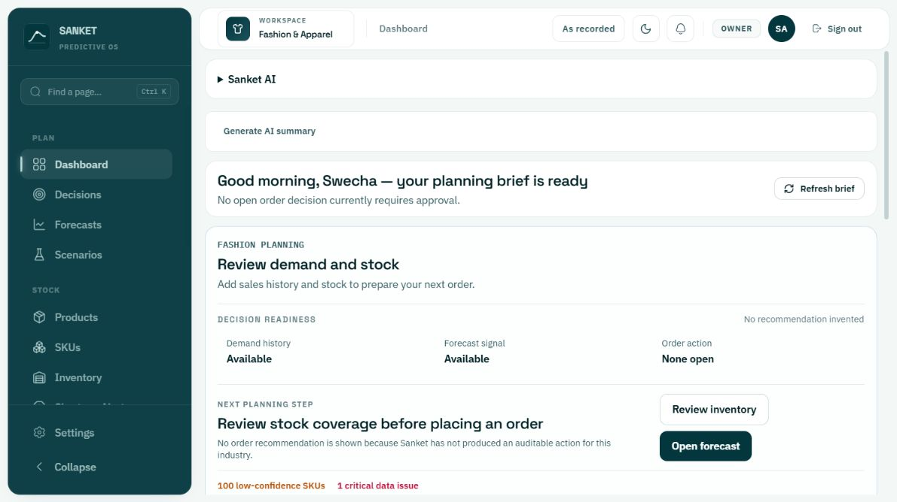
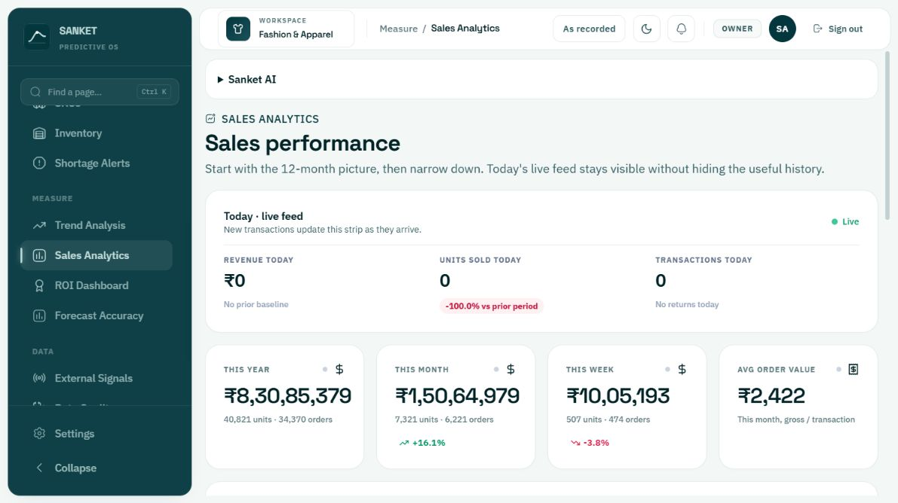
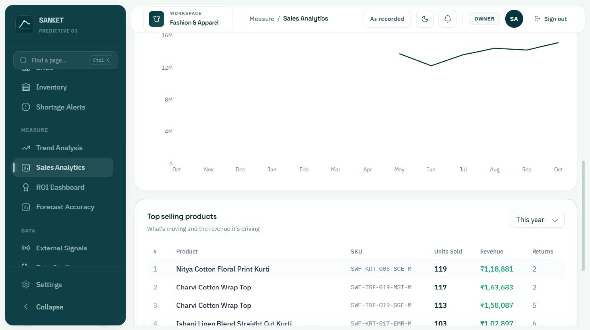
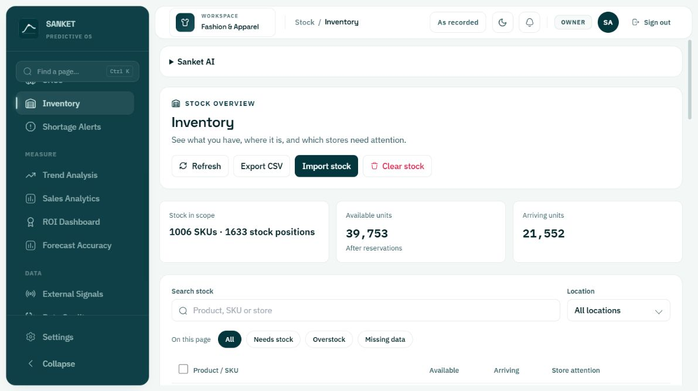
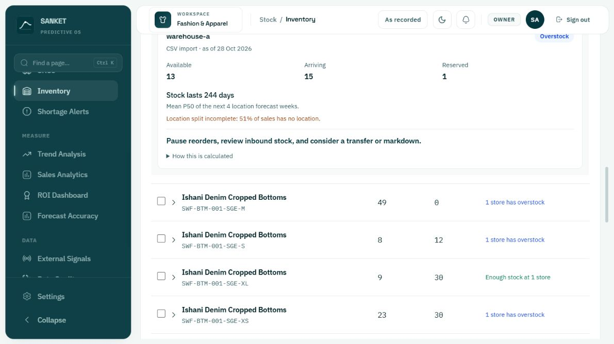
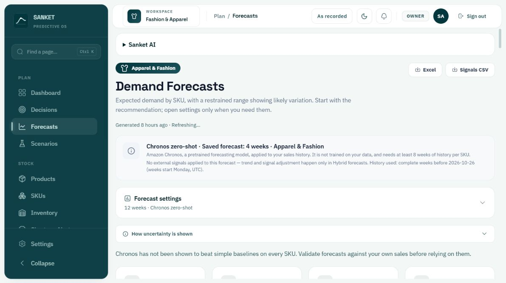
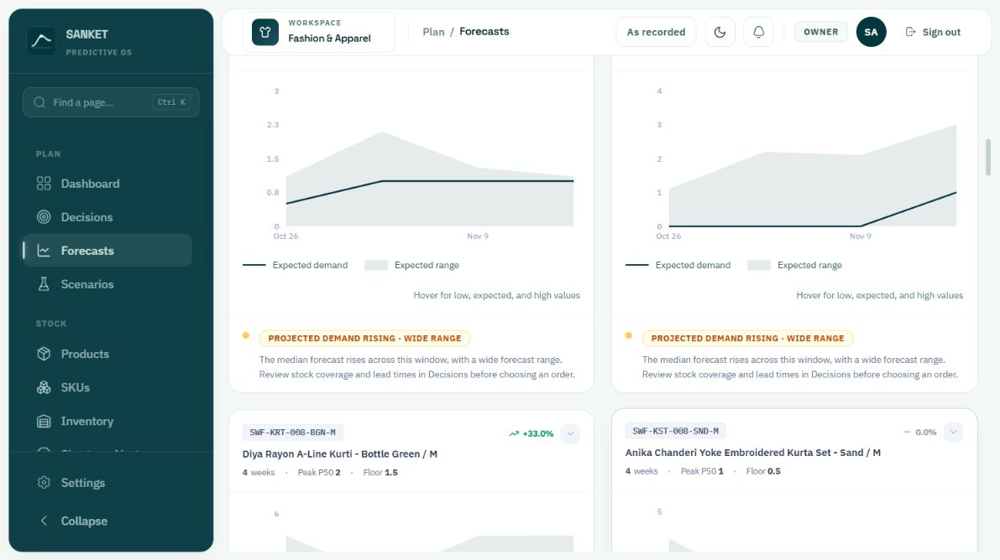
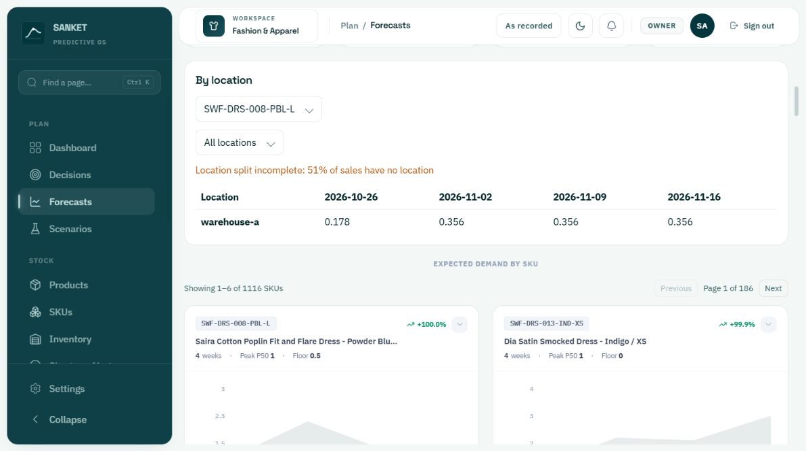

# Data presentation review — 28 October 2026

Scope: signed-in Fashion & Apparel workspace at localhost:5173. Current desktop viewport, light mode. Goal: understand sales performance, stock attention, expected demand, and location differences without interpreting implementation terminology.

## Overall finding

Useful data exists, but large introductory panels displace it, operational context is separated from numbers, and controls limit exploration. Preserve the existing teal identity and truthful warnings; change information order and interaction design.

## 1. Dashboard — needs improvement

The first viewport contains an AI accordion, AI-summary action, greeting, and large readiness panel. Forecast and planning totals come later. The page asks users to add sales history while also reporting demand history and forecast signals available. This needs a specific explanation of the missing prerequisite. Strength: inventory/forecast links and data-quality warnings are present.

Proposal: compact header, scoped business totals, actual-versus-expected chart, then ranked attention list. Keep readiness issues visible as a concise banner with a specific next step. Avoid implying that no open recommendation proves no stock problem exists.

## 2. Sales — needs improvement

Today's zero-valued live strip takes precedence over historical performance. Units show -100% versus an unnamed prior period; month/week deltas also lack an explicit comparison interval. Revenue cards use Indian grouping while the chart uses M. The chart repeats October without visible year labels and leaves a long blank span before available points. Strength: historical revenue, units, orders, and product ranking are available.

Proposal: shared date range and comparison controls; compact live status; revenue and units trend with explicit currency and readable dates; sortable product performance table. Distinguish unavailable history from zero sales. Verify period calculations before changing numerical claims.

## 3. Inventory — useful detail, weak discovery

The table starts below almost the whole first viewport. Attention filters apply only to 25 currently fetched rows despite 1,006 total SKUs; this is disclosed but prevents a complete shortage search. The overview lacks visible cover and urgency columns. Expanding a SKU reveals useful location cover, provenance, incomplete-location warnings, and suggested review steps.

Proposal: compact toolbar and totals, inventory-wide attention filters/counts, sortable rows with cover and status, and a store detail panel. Global filtering requires backend-aware pagination and is more work than styling. Retain unknown coverage as unknown. Move Clear stock to a secondary management menu.

## 4. Forecasts — needs substantial improvement

Model explanation, settings, uncertainty help, and caveats occupy the first viewport before demand data. Saved run says four weeks while settings says twelve weeks; clarify saved versus requested horizon. Six chart cards per page yield 186 pages for 1,116 SKUs. No search or sorting is offered in this captured view. Peak P50/Floor terminology requires interpretation. Chart dropdown buttons appear unnamed in the accessibility tree. Omitted SKU entries expose UUIDs instead of recognizable products.

Proposal: searchable forecast table with product, expected units over the selected window, change with stated baseline, range, and readiness status; one selected SKU chart with actual history and forecast clearly separated. Place model methodology in an expandable details section and retain a concise visible limitation notice. Show omitted products by name/code with corrective steps. Review accessible names and keyboard access to exact chart values.

## 5. Regional/location forecast — incomplete comparison experience

The accessible surface is called By location inside Forecasts; no separately named Regional Forecast appears in the current navigation. Selecting a SKU exposes a second selector and a date-column table. The initial SKU selector offers only the six SKUs on the current chart page. For the inspected SKU, only warehouse-a is offered and 51% of sales lack location. Values such as 0.178 and 0.356 have no visible units, total, historical comparison, or visible low/high range. Preserve fractional expected demand rather than rounding it to misleading whole units.

Proposal: searchable selection independent of chart pagination; explicitly labelled expected units/week; sensible display precision with exact values available; totals and visible ranges; ranked location comparisons only where actual data supports them. Show the missing-location share beside the comparison and link to its correction workflow. A geography map requires actual region mappings; do not fabricate them from warehouse names.

## Accessibility and evidence limits

Muted small chart labels and helper copy need measured contrast checks. Forecast icon controls need accessible names; hover-only detail needs keyboard and touch alternatives. Existing navigation links, labelled selectors, skip link, and inventory expand/collapse names are strengths. This review does not establish WCAG compliance. Mobile, zoom, keyboard-only completion, screen-reader output, exports, loading/error recovery, and alternative tenants were not tested. Numerical correctness and upstream completeness were not verified. The persistent Refreshing label was observed; its root cause was not investigated.

## Proposed direction and trade-offs

1. Cosmetic tightening alone: least work, but leaves page-local filters, missing comparison context, and SKU discovery unresolved.
2. Recommended: shared date/scope/freshness conventions and compact summaries; task-specific tables and charts; searchable drill-downs; explicit missing-data states. Preserve current visual identity. Requires UI changes and potentially API changes for global filtering.
3. Full visual rebrand: widest scope and least direct benefit to the observed problems; defer.

Suggested sequence after design approval: Forecasts/location discovery and labels; Inventory global attention; Sales comparisons; Dashboard summary and attention. Each implementation task needs a failing behavior test, targeted verification, and final repository checks under AGENTS.md.

No application source was changed. No application tests were run for this observational audit.
